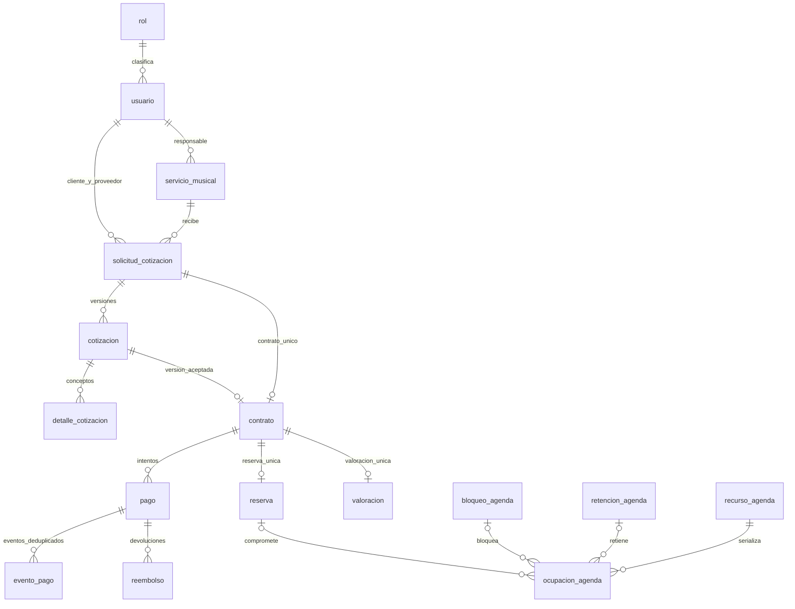

# Modelo conceptual de base y evolución

El texto siguiente conserva el modelo conceptual histórico de V001–V004. Sus conteos de 30 tablas y Room v1 corresponden a esa etapa. El esquema vigente tiene 36 tablas de negocio, Flyway V001–V007 y Room v3. Para el corte actual consultar Modelo_Logico_Actual.md, Modelo_Relacional_Actual.mmd y Diccionario_Datos_Actual.md. Las retenciones y el diseño de pasarela descritos en el modelo inicial no se presentan como módulos operativos de pagos directos.

# Modelo lógico y físico implementado — Etapa 2

Actualización Etapa 3: este inventario describe V004. La extensión vigente V005 y las dos tablas nuevas se documentan en [autenticacion_etapa3.md](autenticacion_etapa3.md). El backend aplica ahora cinco migraciones.

Línea base SQL: V001–V004. Las 14 entidades del diagrama anterior se conservan y se amplían a 30 tablas físicas para normalizar contenido, sesiones, agenda compartida, pagos verificables y eventos. No hay tablas Banda/Solista duplicadas ni una encuesta sustitutiva de RF-68.

El esquema se aplicó y probó en MySQL 8.0.30 en una instancia local aislada. Corte: 03/11/2026 14:52:55, America/Lima. Ver tests/evidence/resultado_mysql.json y ../docs/pruebas/verificacion_etapa2.md. No hay aún API desplegada ni pasarela integrada.

| Tabla física | Origen | Responsabilidad |
|---|---|---|
| bloqueo_agenda | Conservada de las 14 entidades | Bloqueo manual requiere protocolo comun de recursos |
| contrato | Conservada de las 14 entidades | Aceptacion inmutable; no reserva hasta pago verificado |
| cotizacion | Conservada de las 14 entidades | Versiones historicas de propuesta economica |
| detalle_cotizacion | Conservada de las 14 entidades | Desglose exacto sin float o double |
| evento_medicion | Ampliación justificada | Eventos minimos de busqueda; no encuesta ni direccion privada |
| evento_outbox | Ampliación justificada | Salida fiable: escritura con negocio y entrega posterior |
| evento_pago | Ampliación justificada | Bandeja de eventos autenticados; API del proveedor verifica el cobro |
| historial_operacion | Conservada de las 14 entidades | Auditoria conservada al cancelar o despublicar |
| horario_atencion | Conservada de las 14 entidades | Franjas recurrentes; cruzar medianoche requiere dos franjas |
| imagen_servicio | Ampliación justificada | Metadatos de imagen; archivo fuera de MySQL |
| incidencia_pago | Ampliación justificada | Cobro externo no aplicado y otras incidencias auditables |
| integrante | Ampliación justificada | Contenido normalizado y vinculo de recurso compartido |
| notificacion | Conservada de las 14 entidades | Notificaciones persistentes por destinatario |
| ocupacion_agenda | Ampliación justificada | Ocupacion por recurso; exclusion temporal depende del protocolo transaccional |
| pago | Conservada de las 14 entidades | Intentos, cobro externo y aplicacion contractual diferenciados |
| recuperacion_acceso | Ampliación justificada | Recuperacion segura, sin guardar credenciales |
| recurso_agenda | Ampliación justificada | Mutex transaccional por servicio o musico; SELECT FOR UPDATE ordenado |
| reembolso | Ampliación justificada | Devoluciones externas idempotentes y conciliables |
| repertorio | Ampliación justificada | Repertorio individual por servicio |
| reserva | Conservada de las 14 entidades | Una reserva por contrato; fechas derivadas de snapshot contractual |
| retencion_agenda | Ampliación justificada | Soporte opcional de checkout asincrono; no obliga a habilitarlo |
| rol | Conservada de las 14 entidades | Cuatro roles; no crea cuentas de usuario |
| servicio_genero | Ampliación justificada | Lista de generos consultable por SQL |
| servicio_instrumento | Ampliación justificada | Instrumentos publicos del servicio |
| servicio_musical | Conservada de las 14 entidades | Banda o servicio individual de solista |
| servicio_tipo_evento | Ampliación justificada | Tipos de evento del perfil publico |
| sesion | Ampliación justificada | Rotacion y revocacion futura de sesiones reales |
| solicitud_cotizacion | Conservada de las 14 entidades | Solicitud sin reserva de horario |
| usuario | Conservada de las 14 entidades | Cuentas reales; baja logica preserva historia |
| valoracion | Conservada de las 14 entidades | Valoracion; no se crea encuesta de RF-68 pendiente de conciliacion |

## Relaciones y cardinalidades principales

El diagrama físico completo está en [diagramas/modelo_relacional.mmd](diagramas/modelo_relacional.mmd). Todas las columnas, PK, FK, índices y CHECK constan en [diccionario_datos.md](diccionario_datos.md), generado desde INFORMATION_SCHEMA.

## Decisiones respecto a la propuesta anterior

1. **Normalización del contenido.** Integrante, repertorio e imagen_servicio pasan de listas TEXT/JSON a tablas hijas para CRUD individual, orden, consentimiento de vínculo y galería. servicio_genero, servicio_instrumento y servicio_tipo_evento separan listas consultables sin crear catálogos administrativos artificiales. JSON se reserva para el snapshot histórico y metadatos, no para esconder relaciones consultables.
2. **Una identidad musical.** ServicioMusical distingue BANDA/SOLISTA; un índice único sobre una columna calculada limita a un servicio individual por usuario. El rol válido del responsable se verifica en el Service, no lo deduce el índice.
3. **Aceptación coherente.** UNIQUE(id_solicitud) en contrato evita aceptar dos versiones de la misma solicitud. FK compuestas vinculan contrato→cotización/solicitud y conservan servicio/cliente/proveedor coherentes con la solicitud. Esos IDs históricos en contrato permiten autorizar/indexar sin depender de cambios posteriores del responsable actual.
4. **Historia contractual.** Triggers impiden editar la economía/horas de una cotización enviada o sus conceptos, volverla a borrador y alterar/borrar el snapshot contractual. Para enviar se exige desglose con suma exacta. Los cambios generan otra versión. La creación de contrato comprueba estado, vigencia, total, horario y política de la versión. La autenticación y aceptación efectiva del actor se completarán en backend.
5. **Importes exactos.** BIGINT firmado en céntimos PEN; límite por importe de 999999999999 céntimos. Cantidades DECIMAL(10,3); cada concepto redondea una sola vez al céntimo con ROUND decimal y después se suman conceptos. Descuento menor que subtotal; total calculado. No hay float/double. Cambiar la política de redondeo exigirá versión y pruebas.
6. **Pagos trazables.** Clave idempotente por contrato y referencia externa única por proveedor. La huella permite al Service detectar reutilización de la clave con otro contenido. Eventos webhook y devoluciones tienen claves de deduplicación propias. Una FK comprueba que el proveedor del reembolso corresponde al pago. El estado externo, cobrado_en y aplicado_en son distintos; una incidencia con cobro externo no acredita automáticamente saldo o reserva.
7. **Agenda compartida.** recurso_agenda da una fila de bloqueo estable a cada servicio/músico. ocupacion_agenda registra recursos comprometidos con un solo origen (reserva/bloqueo/retención). El conjunto y las horas se conservan como snapshot. El protocolo completo de bloqueo/consulta/escritura se define en protocolo_agenda.md y fue probado con dos conexiones simultáneas. Las tablas solas no impiden que SQL arbitrario omita ese protocolo.
8. **Retenciones técnicas.** Se incluye su soporte por el flujo asíncrono de pago; habilitarlo y definir TTL es decisión del backend/pasarela. Son distintas de reservas confirmadas y caducan para consulta aunque un conciliador aún no haya actualizado su estado.
9. **Sesiones y recuperación.** Se guardan hashes de tokens aleatorios, familia de rotación, consumo/revocación y expiración. La contraseña humana requiere hash adaptativo en backend. No hay tokens/contraseñas precargados en las migraciones.
10. **Tiempo y privacidad.** DATETIME(6) en UTC con sesiones UTC; TIME de horario recurrente es hora local America/Lima. Se usa intervalo semiabierto [inicio,fin). El catálogo solo expone perfiles publicados de cuentas activas; lugares de eventos, motivos de bloqueo y finanzas quedan en recursos privados del backend.
11. **Métricas y entrega de eventos.** EventoMedicion contiene eventos voluntarios mínimos de búsqueda; no encuesta ni resultados inventados. EventoOutbox permite persistir el evento en la misma transacción y entregarlo después. Indicadores y exportaciones usarán hechos fechados del servidor.
12. **Bajas y restricciones.** FK explícitas con RESTRICT preservan referencias; contrato tiene además trigger de no borrado. Suspensión/retiro/cancelación son cambios de estado. El backend tendrá privilegios limitados; no se otorga DDL o borrado de historia a Android ni al usuario final.

## Separación central y local

MySQL es fuente oficial de las 30 tablas. Room permanece con servicio_cache v1 (resumen público: id, nombre, tipo, ciudad, tarifaCentimos, sincronizadoEn), sin cambios en esta etapa. No se copia automáticamente el esquema central a SQLite. Una futura caché privada necesitará aislamiento por usuario, retención y limpieza al cerrar sesión.

## Validaciones que siguen siendo de backend

Permisos por rol y propietario; creación y publicación autorizadas; validación completa de correo/contraseña/archivos; días de atención y solapamiento de franjas recurrentes; fecha futura de evento y vigencia del proceso; resolución completa de recursos; límite del saldo/suma de reembolsos bajo bloqueo; transiciones válidas de negocio; identidad y firma de webhooks; moneda/importe/referencia con proveedor; aplicación atómica del primer abono/reserva; reintentos de outbox, conciliación y política de cancelación. Los CHECK solo validan condiciones estructurales de sus filas; los timestamps financieros no son prueba de una consulta auténtica al proveedor.

La escala operativa de valoración es 1–5 y la discrepancia de encuesta de RF-68 sigue pendiente de conciliación formal. No se declara instrumento de investigación validado ni se amplía silenciosamente la numeración de requisitos.
