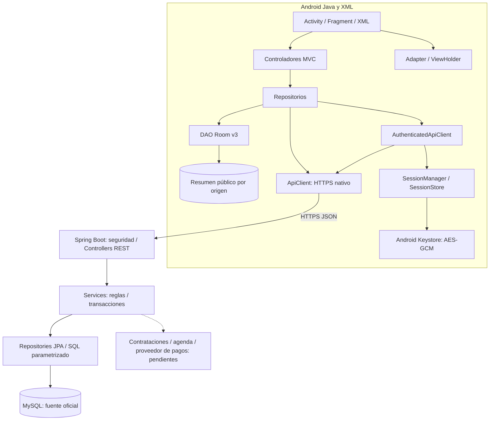

# Arquitectura general — estado de Etapa 5

Android Java/XML presenta acceso, cuenta y consultas públicas mediante MVC. El backend Spring Boot implementa la autoridad de identidad, permisos y publicación de servicios; MySQL es su fuente oficial. Contratación, agenda operativa y pagos permanecen en sus etapas posteriores.

## Consulta y caché

CatalogoFragment delega en CatalogoController y ServicioRepository. ExecutorService ejecuta Room y red sin bloquear la interfaz; Handler entrega resultados al hilo principal. El catálogo consulta primero Room y solicita un snapshot público completo por HttpsURLConnection. Valida JSON e importes en céntimos, transforma transporte → dominio → entidad y sustituye la caché dentro de una transacción. completo=true evita reemplazarla con una página parcial. Una lista vacía válida retira servicios antiguos; errores conservan el resumen previo y se informan en pantalla.

Room v2 añadió cache_scope y MIGRATION_1_2; v3 agrega géneros/instrumentos con MIGRATION_2_3, sin allowMainThreadQueries ni fallback destructivo. Solo contiene resúmenes públicos ligados al origen de la API. Cambiar de entorno descarta la caché del origen anterior; la caché v1 sin origen se renueva. El perfil público ampliado y repertorio se consultan online. Ningún dato cacheado confirma disponibilidad o precio contractual.

## Acceso y ciclo de vida

AuthController y CuentaController coordinan AuthRepository. SessionManager restaura/guarda el perfil mínimo y los tokens reales en SessionStore, cifrados AES-256-GCM con clave no exportable de Android Keystore y archivo no_backup. No se conserva contraseña. Los tokens no están en Room ni en logs. La revisión de sesión impide que una respuesta tardía resucite una cuenta cerrada; la renovación rotatoria se coordina entre consultas. El servidor conserva solo hashes de tokens.

Cada vista cancela consultas al detenerse. La rotación ya iniciada completa su persistencia aunque se abandone una vista; el cierre de sesión completa su limpieza local. Un fallo de conexión antes de enviar el refresh conserva el acceso guardado para un intento posterior. Un resultado incierto o token rechazado requiere nuevo ingreso. No hay cola de mutaciones offline. El perfil propio sin conexión se marca no verificado y nunca autoriza acciones.

## Transporte y entornos

Volley fue retirado. ApiClient admite únicamente endpoints registrados sobre URL base HTTPS sin credenciales/query/fragmento, valida certificados y hostname con la plataforma, no sigue redirecciones ni reintenta POST automáticamente. Define tiempos límite y respuestas de hasta 2 MiB. Debug puede confiar en el certificado público local solo para los hosts del emulador; release confía en certificados del sistema. Android 17 solicita acceso a red local exclusivamente para el endpoint local de debug.

[Guía de integración](integracion_android.md) contiene los comandos y límites. No existe JDBC Android–MySQL. El namespace Android se conserva; el backend usa com.santacecilia.api. Los importes son enteros PEN en céntimos y los instantes oficiales están en UTC.

## Alcance del servidor y etapas siguientes

Spring Boot utiliza DTOs validados, seguridad por rol y propiedad, Services transaccionales, Flyway V001–V007 y Hibernate validate. Implementa cuentas, autenticación, auditoría y administración/publicación de servicios; [API efectiva](../backend/API.md). La recuperación envía enlaces mediante SMTP en una cola en memoria, con sus límites documentados; el outbox durable de notificaciones de negocio sigue previsto.

ServicioMusical representa banda o solista mediante TipoServicio. No se crean modelos redundantes Banda/Solista. Un enum o etiqueta de rol del cliente nunca concede permisos en servidor. El futuro flujo financiero requerirá idempotencia, conciliación y transacciones MySQL; no se confirma mediante Room.

La interfaz actual es funcional para integrar datos. Etapa 5 implementa dashboards por rol, gestión de cuentas/servicios y formularios, comparación/filtros, fuentes locales y revisión de tamaños. Las fotografías originales no fueron accesibles; se mantiene un recurso musical vectorial. Ver [interfaz.md](interfaz.md). El historial de las primeras etapas y sus verificaciones se conserva en docs/pruebas; no equivale a una certificación de la aplicación completa.

Etapa 6 incorpora ContratacionService/ContratacionRepository transaccionales y su API autorizada. Las solicitudes, propuestas versionadas, aceptación idempotente y snapshots se comparten mediante MySQL; Android conserva solo borradores de pantalla. La agenda serializa recursos, usa intervalos semiabiertos y franjas en America/Lima. El historial y las notificaciones internas se guardan en la transacción del negocio; la bandeja/entrega externa de notificaciones sigue pendiente. El contrato aceptado no crea ocupación hasta integrar el primer pago verificado en Etapa 7. Véase contratacion_agenda.md.

Etapa 7: pagos directos elegidos por el usuario, con reporte de comprobante y conciliación administrativa. PagoDirectoService separa importe previsto, ingreso verificado y abono aplicado, crea la primera reserva atómicamente y conserva incidencias/devoluciones. ComprobanteImagenService normaliza archivos privados; PagoAvisosService entrega avisos durables desde outbox. No hay integración bancaria automática ni credenciales de pasarela. Ver pagos_arquitectura.md.
